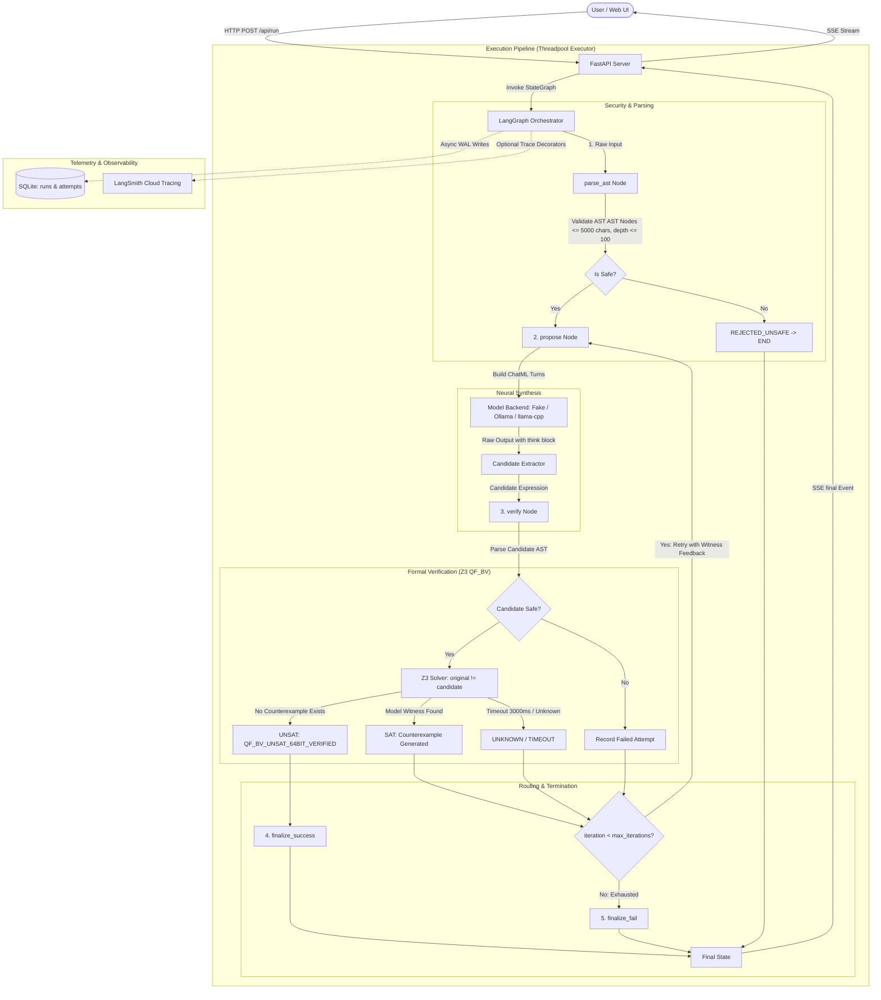

# PALIMPSEST (Codename VEX-MORPH) — Architecture Specification

## 1. Executive Summary & Core Philosophy

**PALIMPSEST** is a local, neurosymbolic de-obfuscation engine for 64-bit Mixed Boolean-Arithmetic (MBA) expressions.

In binary protection, code obfuscators rewrite simple instructions (such as `x + y`) into large, cryptic identities interlaced with opaque predicates (such as `(x ^ y) + 2 * (x & y) + ((x | y) - (x & y)) * 0`). Traditional decompilers rely on rigid pattern-matching heuristics that fail when faced with novel rewrite rules. Solvers alone cannot discover clean, minimal representations because the search space of algebraic expressions is infinite.

PALIMPSEST unites the complementary strengths of Machine Learning and Formal Methods via **Counterexample-Guided Inductive Synthesis (CEGIS)**:
> **"The AI proposes, the math proves."**
> Search is hard, checking is easy.

- **The Neural Proposer**: A fine-tuned, 4-bit quantized SLM (Small Language Model, Qwen2.5-Coder-3B-Instruct) proposes compact candidate expressions.
- **The Symbolic Judge**: Microsoft Z3 (an SMT solver operating over 64-bit BitVec logic, QF_BV) checks candidate equivalence against the original expression. If unequal, Z3 synthesizes a concrete counterexample witness (e.g. `x=1, y=1; expected=2, actual=0`), which is fed back into the model to refine its hypothesis.
- **The Orchestrator**: LangGraph manages the iterative loop, routing proposals through formal verification until an exact mathematical proof is reached or iteration limits are exhausted.

### Honest Claims & Guardrails
- **Zero Unverified Answers Accepted**: PALIMPSEST will **never** present an unverified hypothesis as proven. A candidate is accepted if and only if Z3 emits `UNSAT` on the equivalence miter condition `original != candidate`.
- **Honest Failure**: If the model fails within the retry limit or Z3 times out, the result is visibly flagged as `NOT VERIFIED (FAILED)`.
- **Scope Limit**: PALIMPSEST targets 64-bit MBA expressions. Full binary de-compilation, control-flow flattening, and multi-statement interprocedural analysis are out of scope for v1.

---

## 2. System Architecture



---

## 3. LangGraph State Machine Specification

### 3.1 State Schema (`PalimpsestState`)

```python
from typing import TypedDict, List, Optional, Dict, Any

class AttemptRecord(TypedDict):
    iteration: int
    candidate: str
    raw_output: str
    status: str            # "QF_BV_UNSAT_64BIT_VERIFIED" | "SAT" | "UNKNOWN" | "INVALID"
    latency_ms: float
    witness: Optional[Dict[str, int]]
    expected: Optional[int]
    actual: Optional[int]
    diff_bits: Optional[str]  # 64-char binary string of (expected ^ actual)

class PalimpsestState(TypedDict):
    obfuscated_expr: str
    obf_nodes: int
    iteration: int
    max_iterations: int
    current_candidate: Optional[str]
    current_raw_output: Optional[str]
    verification_result: Optional[Dict[str, Any]]
    history: List[AttemptRecord]
    final_status: Optional[str]   # "VERIFIED_EQUIVALENT" | "FAILED" | "REJECTED_UNSAFE"
    final_expr: Optional[str]
    final_nodes: Optional[int]
    compression_pct: Optional[float]
    error_message: Optional[str]
    temperature: float            # Adjusted upwards if model repeats candidates
```

### 3.2 Graph Nodes

1. **`parse_ast`**:
   - Validates input length ($\le 5000$ characters).
   - Parses AST with Python `ast.parse(expr, mode='eval')`.
   - Enforces the strict Node allowlist and recursion depth threshold ($\le 100$).
   - Calculates `obf_nodes` count.
   - Initializes `iteration = 0`, `history = []`, `temperature = 0.2`.
   - If invalid, sets `final_status = REJECTED_UNSAFE` and routes directly to `END`.

2. **`propose`**:
   - Assembles messages matching the training format:
     - Turn 1: `user` $\rightarrow$ `"De-obfuscate this 64-bit MBA expression:\n{expression}"`
     - CEGIS Turns: Formatted previous attempt + Z3 failure witness turn.
   - Dispatches to configured backend (`fake`, `ollama`, or `llamacpp`).
   - Extracts candidate string from output (lines following `</think>`).
   - Increments `iteration += 1`.
   - Checks if candidate is identical to a prior failed attempt; if so, boosts `temperature += TEMP_RETRY_INCREMENT`.

3. **`verify`**:
   - Evaluates candidate string against security gate.
   - If candidate is syntactically invalid or unsafe, registers an `INVALID` attempt.
   - Executes Z3 64-bit BitVec miter check with timeout (`3000ms`).
   - Computes `diff_bits` when `status == "SAT"`.
   - Appends `AttemptRecord` to `history`.

4. **`finalize_success`**:
   - Sets `final_status = "VERIFIED_EQUIVALENT"`.
   - Counts `final_nodes` and computes `compression_pct = round((1 - final_nodes / obf_nodes) * 100, 2)`.

5. **`finalize_fail`**:
   - Sets `final_status = "FAILED"`.

### 3.3 Conditional Router (`route_after_verify`)
- If `status == "QF_BV_UNSAT_64BIT_VERIFIED"` $\rightarrow$ `finalize_success`
- Else if `iteration >= max_iterations` $\rightarrow$ `finalize_fail`
- Else $\rightarrow$ `propose` (CEGIS loop)

---

## 4. Formal Verification: Z3 Bit-Vector (QF_BV) Contract

### 4.1 Verification Contract
```python
def verify_equivalence(
    original_expr: str,
    candidate_expr: str,
    timeout_ms: int = 3000
) -> Dict[str, Any]:
    """
    Formally verifies equivalence; equivalence proven by Z3 (QF_BV, 64-bit).
    Returns:
        status: "QF_BV_UNSAT_64BIT_VERIFIED" | "SAT" | "UNKNOWN" | "INVALID"
        witness: dict[str, int] (variable assignments disproving equivalence)
        expected: int (original expression value at witness, 64-bit unsigned)
        actual: int (candidate expression value at witness, 64-bit unsigned)
        diff_bits: str (64-character binary string showing bit discrepancies)
        latency_ms: float
    """
```

### 4.2 AST to Z3 BitVec Translation Rules
All variables and integer constants are mapped into 64-bit bit-vectors (`z3.BitVec(name, 64)` and `z3.BitVecVal(val & 0xFFFFFFFFFFFFFFFF, 64)`).
- `+` $\rightarrow$ `x + y` (Bit-vector addition with implicit 64-bit unsigned modulo wrapping)
- `-` $\rightarrow$ `x - y`
- `*` $\rightarrow$ `x * y`
- `&` $\rightarrow$ `x & y`
- `|` $\rightarrow$ `x | y`
- `^` $\rightarrow$ `x ^ y`
- `~` $\rightarrow$ `~x`
- `-x` (unary) $\rightarrow$ `-x`
- `<<` $\rightarrow$ `x << (y & 63)` (Logical shift left, bounded by bit-width)
- `>>` $\rightarrow$ `z3.LShR(x, y & 63)` (Logical shift right)

### 4.3 Miter Formulation
To prove equivalence:
$$\exists x_1, x_2, \dots, x_k \in \mathbb{BV}_{64} \quad \text{s.t.} \quad E_{\text{orig}}(x_1, \dots, x_k) \neq E_{\text{cand}}(x_1, \dots, x_k)$$

- If solver returns **`UNSAT`**: No counterexample exists. Equivalence proven by Z3 (QF_BV, 64-bit) $\rightarrow$ `QF_BV_UNSAT_64BIT_VERIFIED`.
- If solver returns **`SAT`**: Solver provides a concrete model $M$. We evaluate $E_{\text{orig}}$ and $E_{\text{cand}}$ under $M$ to obtain concrete integers `expected` and `actual`, and format the counterexample witness.
- If solver returns **`UNKNOWN`** or times out ($> 3000\text{ ms}$): Verification fails gracefully without crashing.

---

## 5. Security & Isolation Architecture

PALIMPSEST processes untrusted expressions from arbitrary users and generated by local LLMs.
Strict constraints are enforced:
1. **Never `eval()` or `exec()`**: AST parsing and evaluation is done exclusively through safe recursive visitors building symbolic Z3 structures or counting nodes.
2. **Strict Node Whitelist**:
   - `ast.Expression`
   - `ast.BinOp` with operators `Add`, `Sub`, `Mult`, `BitAnd`, `BitOr`, `BitXor`, `LShift`, `RShift`
   - `ast.UnaryOp` with operators `Invert`, `USub`
   - `ast.Name` with `ast.Load`
   - `ast.Constant` strictly restricted to `isinstance(node.value, int)`
   - All other AST types (`Call`, `Attribute`, `Import`, `Str`, `List`, `Lambda`, `Subscript`, etc.) trigger immediate rejection.
3. **DoS Prevention**:
   - Input length limit: $\le 5,000$ characters.
   - Max AST recursion depth: $\le 100$ levels.
4. **Execution Isolation**:
   - Z3 solver invocations run within synchronous worker threads managed by FastAPI's `run_in_threadpool`, keeping the main async event loop responsive.

---

## 6. Model Backends & Training Format Compatibility

### 6.1 Training Data Exact Prompt Format
PALIMPSEST models are trained on specific ChatML message sequences.

#### Turn 1 (Initial User Prompt):
```
De-obfuscate this 64-bit MBA expression:
{expression}
```

#### Turn 2 (Assistant Response):
The assistant emits reasoning followed by the final candidate expression:
```
<think>
[Template-generated reasoning steps]
</think>
x + y
```

#### Turn 3 (CEGIS Tool Feedback):
When an attempt is rejected by Z3 with `SAT`, the feedback is formatted exactly:
```
Z3_VERIFICATION_FAILED: SAT
Counterexample Witness: {'x': 1, 'y': 1}
Expected: 2, Actual: 0
```

#### Turn 4 (Corrected Assistant Response):
The assistant refines its hypothesis based on the concrete counterexample.

### 6.2 [CONFIRM] Items & Config Defaults
To guarantee smooth interoperability with the model trained by the teammate:
1. **`TOOL_ROLE`**: Defaults to `"user"`. (Many standard ChatML templates do not define a separate `"tool"` role; configurable to `"tool"` via `.env`).
2. **`SYSTEM_PROMPT`**: Defaults to `None` / empty string. (Qwen ChatML standard system prompts are suppressed unless explicitly configured).
3. **`HISTORY_MODE`**: Defaults to `"last"`. (Training data only ever provided the most recent failed attempt in context. Configurable to `"all"`).
4. **`Chat Template`**: ChatML format delivered via `Modelfile` for Ollama.

### 6.3 Backend Abstraction Interface
- `fake`: Pure deterministic backend for local dev, automated testing, and CI. Returns `x ^ y` on turn 1 (forcing a SAT counterexample), and `x + y` on turn 2 (achieving UNSAT proof).
- `ollama`: Communicates via `ollama.chat` with local daemon on `http://localhost:11434`.
- `llamacpp`: Loads GGUF weights via `llama-cpp-python` with multi-threaded CPU execution.

---

## 7. API & Streaming Protocol (SSE)

### 7.1 Endpoints
- `POST /api/run` — Initiates synthesis loop, streaming Server-Sent Events (SSE).
- `GET /api/history?limit=50` — Retrieves paginated past runs from SQLite.
- `GET /api/runs/{run_id}` — Retrieves detailed run data and attempt timeline.
- `GET /api/stats` — Summary metrics (overall success rate, avg attempts, avg Z3 latency).
- `GET /api/health` — System health check (active backend, model connectivity, Z3 status, LangSmith status).
- `GET /api/examples` — Pre-loaded MBA expressions for interactive exploration.

### 7.2 SSE Event Stream Contract
Events are pushed using the standard `text/event-stream` protocol:
```
event: run_started
data: {"run_id": "c1f7b0...", "expression": "(x ^ y) + 2 * (x & y)", "obf_nodes": 9, "max_iterations": 5, "backend": "fake"}

event: node_started
data: {"node": "parse_ast"}

event: node_finished
data: {"node": "parse_ast"}

event: proposal
data: {"iteration": 1, "raw_output": "<think>...</think>\nx ^ y", "think": "...", "candidate": "x ^ y"}

event: verification
data: {"iteration": 1, "candidate": "x ^ y", "status": "SAT", "latency_ms": 1.42, "witness": {"x": 1, "y": 1}, "expected": 2, "actual": 0, "diff_bits": "0000000000000000000000000000000000000000000000000000000000000010"}

event: retry
data: {"iteration": 1, "feedback_message": "Z3_VERIFICATION_FAILED: SAT\nCounterexample Witness: {'x': 1, 'y': 1}\nExpected: 2, Actual: 0"}

event: final
data: {"status": "VERIFIED_EQUIVALENT", "final_expr": "x + y", "obf_nodes": 9, "final_nodes": 3, "compression_pct": 66.67, "total_ms": 124.5, "attempts": 2}
```

---

## 8. Frontend User Interface Architecture

The frontend is built with React, Vite, TypeScript, and Tailwind CSS, featuring a cyber-lab forensic aesthetic.

### 8.1 Key Views & Components
1. **Command Center**: Expression input with preset buttons, iteration slider, live backend/cloud status pills, and prominent synthesis trigger.
2. **Live Loop Graph (React Flow)**: Visualizes `parse_ast`, `propose`, `verify`, `success`, and `fail`. Displays real-time node pulsing and animated counterexample return edges.
3. **Attempt Timeline**: Collapsible reasoning logs, candidate cards, SAT/UNSAT badges, and Z3 timings.
4. **Counterexample Bit Visualizer**: Interactive 64-bit grid highlighting discrepancies between `expected` and `actual` bit-vectors.
5. **Proof & Compression Banner**: Prominent verification proof banner (green for Z3 verified, honest red for failure) and animated AST node compression percentage.
6. **Explain Mode**: Contextual educational overlays explaining MBA, CEGIS, bit-vectors, and Z3 proofs for students and evaluators.
7. **History & Insights**: Analytical dashboard with Recharts displaying historical run metrics and run replays.

---

## 9. Telemetry & Persistence

- **SQLite WAL Mode**: `palimpsest.sqlite` initialized with `PRAGMA journal_mode=WAL;` and `PRAGMA busy_timeout=5000;`.
- **Database Tables**:
  - `runs`: `run_id`, `timestamp`, `expression`, `obf_nodes`, `final_status`, `final_expr`, `compression_pct`, `attempts`, `total_ms`, `backend`.
  - `attempts`: `id`, `run_id`, `iteration`, `candidate`, `status`, `latency_ms`, `witness_json`, `expected`, `actual`.
- **Async Execution**: SQLite writes are queued in background tasks so telemetry errors never interrupt synthesis.
- **LangSmith Tracing**: Enabled conditionally via `LANGSMITH_TRACING=true`. When active, `@traceable` wraps `propose` (tagged as `llm`) and `verify` (tagged as `tool`), and the UI displays a persistent amber warning badge.

---

## 10. Technology Dependencies

| Component | Library / Tool | Version | Purpose |
| :--- | :--- | :--- | :--- |
| **Backend Framework** | `fastapi` | `0.115.8` | Async REST API & SSE streaming |
| | `uvicorn[standard]` | `0.34.0` | ASGI server |
| **Formal Logic** | `z3-solver` | `4.14.0.0` | 64-bit QF_BV Bit-Vector SMT solver |
| **Agent Orchestration**| `langgraph` | `0.2.70` | CEGIS state machine & cycle routing |
| | `langchain-core` | `0.3.35` | Core schema and message types |
| **Telemetry & Observability**| `langsmith` | `0.3.8` | Optional tracing decorators |
| | `aiosqlite` | `0.21.0` | Async SQLite with WAL support |
| **Model Serving** | `ollama` | `0.4.7` | Python client for local Ollama |
| | `llama-cpp-python` | `0.3.7` | In-process fallback GGUF execution |
| **Frontend Framework** | `react` / `react-dom` | `^19.0.0` | Declarative UI |
| | `vite` | `^6.1.0` | Fast build tool and dev server |
| | `typescript` | `^5.7.3` | Type safety |
| **Styling & Icons** | `tailwindcss` | `^4.0.0` | Utility CSS |
| | `lucide-react` | `^0.475.0` | Cyber/forensic iconography |
| **Graph & Visualization** | `@xyflow/react` | `^12.4.2` | Interactive LangGraph node visualization |
| | `framer-motion` | `^12.4.2` | Smooth state transitions & packet animations |
| | `recharts` | `^2.15.1` | Historical telemetry charts |
