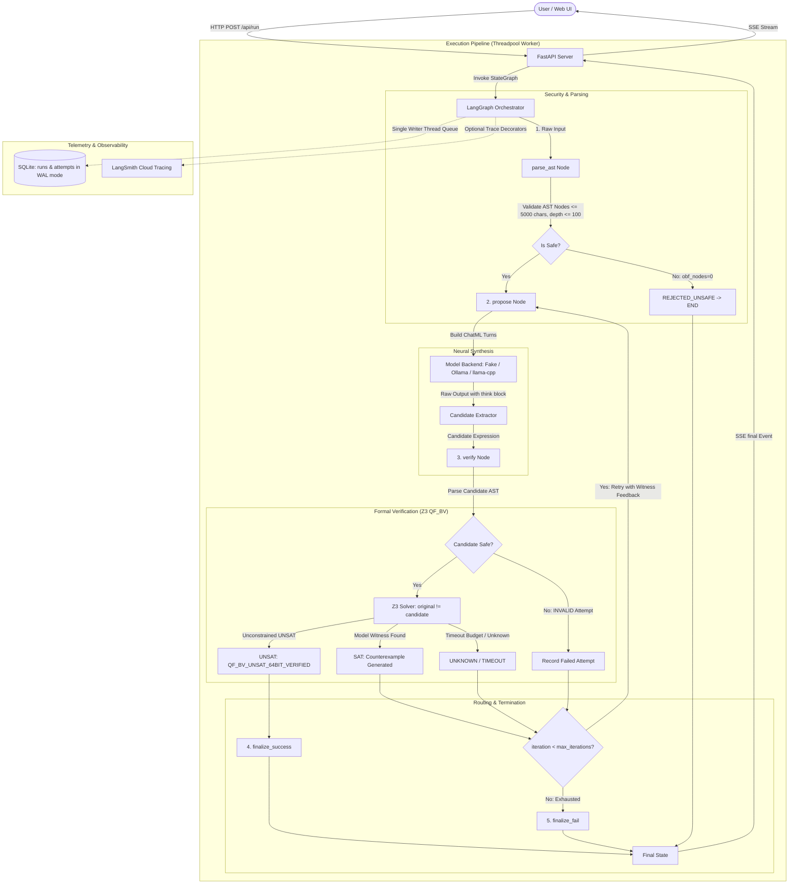

# PALIMPSEST (Codename VEX-MORPH) — Architecture Specification

## 1. Executive Summary & Core Philosophy

**PALIMPSEST** is a local, neurosymbolic de-obfuscation engine for 64-bit Mixed Boolean-Arithmetic (MBA) expressions.

In binary protection, code obfuscators rewrite simple instructions (such as `x + y`) into large, cryptic identities interlaced with opaque predicates (such as `(x ^ y) + 2 * (x & y) + ((x | y) - (x & y)) * 0`). Traditional decompilers rely on rigid pattern-matching heuristics that fail when faced with novel rewrite rules. Solvers alone cannot discover clean, minimal representations because the search space of algebraic expressions is infinite.

PALIMPSEST unites the complementary strengths of Machine Learning and Formal Methods via **Counterexample-Guided Inductive Synthesis (CEGIS)**:
> **"The AI proposes, the math proves."**
> Search is hard, checking is easy.

- **The Neural Proposer**: A fine-tuned, 4-bit quantized SLM (Small Language Model, Qwen2.5-Coder-3B-Instruct) proposes compact candidate expressions.
- **The Symbolic Judge**: Microsoft Z3 (an SMT solver operating over 64-bit BitVec logic, QF_BV) checks candidate equivalence against the original expression. If unequal, Z3 synthesizes a concrete counterexample witness (e.g. `x=1, y=1; expected=2, actual=0`), which is fed back into the model to refine its hypothesis.
- **The Orchestrator**: LangGraph manages the iterative loop, routing proposals through formal verification until an exact mathematical proof is reached or iteration limits are exhausted.

### Honest Claims & Guardrails
- **Zero Unverified Answers Accepted**: PALIMPSEST will **never** present an unverified hypothesis as proven. A candidate is accepted if and only if Z3 emits `UNSAT` on the equivalence miter condition `original != candidate`.
- **Honest Failure**: If the model fails within the retry limit or Z3 times out, the result is visibly flagged as `NOT VERIFIED (FAILED)`.
- **Scope Limit**: PALIMPSEST targets 64-bit MBA expressions. Full binary de-compilation, control-flow flattening, and multi-statement interprocedural analysis are out of scope for v1.

---

## 2. System Architecture



---

## 3. LangGraph State Machine Specification

### 3.1 State Schema (`PalimpsestState`)

```python
from typing import TypedDict, List, Optional, Dict, Any

class AttemptRecord(TypedDict):
    iteration: int
    candidate: str
    raw_output: str
    think: Optional[str]
    status: str            # "QF_BV_UNSAT_64BIT_VERIFIED" | "SAT" | "UNKNOWN" | "INVALID"
    latency_ms: float
    witness: Optional[Dict[str, int]]
    expected: Optional[int]
    actual: Optional[int]
    diff_bits: Optional[str]  # 64-char binary string of (expected ^ actual)

class PalimpsestState(TypedDict):
    obfuscated_expr: str
    obf_nodes: int
    iteration: int
    max_iterations: int
    current_candidate: Optional[str]
    current_raw_output: Optional[str]
    current_think: Optional[str]
    verification_result: Optional[Dict[str, Any]]
    history: List[AttemptRecord]
    final_status: Optional[str]   # "VERIFIED_EQUIVALENT" | "FAILED" | "REJECTED_UNSAFE"
    final_expr: Optional[str]
    final_nodes: Optional[int]
    compression_pct: Optional[float]
    error_message: Optional[str]
    temperature: float            # Adjusted upwards if model repeats candidates
    feedback_message: Optional[str]
```

> [!NOTE]
> Cancellation callbacks (`should_cancel`) are passed to LangGraph via the execution config: `config={"configurable": {"should_cancel": should_cancel}}` and accessed inside nodes via `config.get("configurable", {}).get("should_cancel")`, NOT stored in `PalimpsestState`.

### 3.2 Graph Nodes

1. **`parse_ast`**:
   - The route handler precomputes `obf_nodes` before emitting `run_started` (set to `0` if unsafe).
   - Node `parse_ast` re-validates input length ($\le 5000$ characters) and parses AST with Python `ast.parse(expr, mode='eval')`.
   - Enforces the strict Node allowlist, iterative depth check ($\le 100$), and rejects negative constant shift amounts.
   - Calculates semantic `obf_nodes` count strictly over `BinOp`, `UnaryOp`, `Name`, and `Constant`.
   - If unsafe or invalid, sets `final_status = "REJECTED_UNSAFE"`, `obf_nodes = 0`, and routes directly to `END`.

2. **`propose`**:
   - Checks `should_cancel()` at node entry; aborts immediately if client disconnected.
   - Assembles messages matching the training format:
     - Turn 1: `user` $\rightarrow$ `"De-obfuscate this 64-bit MBA expression:\n{expression}"`
     - CEGIS Turns: Formatted previous attempt + Z3 failure witness turn.
   - Dispatches to configured backend with timeout `MODEL_TIMEOUT_SECONDS` (read from configuration, not hard-coded).
   - Extracts candidate string from output (lines following `</think>`).
   - Increments `iteration += 1`.
   - If candidate was already proposed in history, raises `temperature += TEMP_RETRY_INCREMENT`.

3. **`verify`**:
   - Checks `should_cancel()` at node entry.
   - Evaluates candidate string against security gate.
   - If candidate is syntactically invalid or unsafe (e.g. garbage output from model), registers an `INVALID` attempt.
   - Instantiates a fresh, isolated `z3.Context()` and executes the Z3 64-bit BitVec miter check.
   - Computes `diff_bits` when `status == "SAT"`.
   - Appends `AttemptRecord` to `history`.
   - If not verified and `iteration < max_iterations`, formats feedback:
     - For `SAT`: includes witness, expected, and actual values.
     - For `INVALID` or `UNKNOWN`: retry feedback `Error:` text is strictly single-line, truncated to ~200 characters, and never includes raw model output.

4. **`finalize_success`**:
   - Sets `final_status = "VERIFIED_EQUIVALENT"`.
   - Counts `final_nodes` and computes `compression_pct = round((1 - final_nodes / obf_nodes) * 100, 2)`.

5. **`finalize_fail`**:
   - Sets `final_status = "FAILED"`.
   - Emits `final` event with status `"FAILED"`. No trailing `retry` event is emitted.

### 3.3 Routing & Client-Side Graph Synchronization
- Routing logic:
  - If `status == "QF_BV_UNSAT_64BIT_VERIFIED"` $\rightarrow$ `finalize_success`
  - Else if `iteration >= max_iterations` $\rightarrow$ `finalize_fail`
  - Else $\rightarrow$ `propose` (CEGIS loop)
- **Client-Side Router Node**:
  The server emits events for the five functional nodes: `parse_ast`, `propose`, `verify`, `finalize_success`, `finalize_fail`. The "Router" node is drawn **client-side** in the React Flow graph: when a `verification` event arrives, the UI lights up the decision diamond; if followed by a `retry` event, the UI animates the return packet edge along the retry path back to `propose`.

---

## 4. Formal Verification: Z3 Bit-Vector (QF_BV) Contract

### 4.1 Verification Contract
- **Theory**: Quantifier-Free Bit-Vectors (`QF_BV`).
- **Precision**: 64-bit unsigned bit-vectors (`z3.BitVec(name, 64, ctx=ctx)`).
- **Miter Condition**: `z3.Not(orig_bv == cand_bv)`.
- **Verdict Mapping**:
  - `check() == unsat`: **Proven Equivalent**. Status: `QF_BV_UNSAT_64BIT_VERIFIED`.
  - `check() == sat`: **Disproven (Counterexample Exists)**. Status: `SAT`. Concrete witness extracted.
  - `check() == unknown`: **Solver Inconclusive (Timeout/Resource Limit)**. Status: `UNKNOWN`.
  - Parse / Gate failure: **Invalid Candidate**. Status: `INVALID`.

### 4.2 Non-SAT Verification Contract & Retry Feedback Text
- When candidate fails verification (`INVALID` or `UNKNOWN`), the verification event emits:
  - `witness`: `{}` (empty dictionary)
  - `expected`: `None`
  - `actual`: `None`
  - `diff_bits`: `None`
- Exact Retry Feedback Strings:
  - When status is `INVALID`:
    ```
    Z3_VERIFICATION_FAILED: INVALID
    Error: <sanitized_error_text>
    ```
  - When status is `UNKNOWN` (timeout):
    ```
    Z3_VERIFICATION_FAILED: UNKNOWN
    Error: Z3 solver timeout or resource limit reached
    ```
  - **Constraint**: `<sanitized_error_text>` is strictly single-line, truncated to ~200 chars, and never includes raw model output.

### 4.3 Shift Semantics & Isolation
Configured via `SHIFT_SEMANTICS`:
- **`z3` (Default)**: Standard Z3 / SMT-LIB / Python semantics where shift amounts $\ge 64$ evaluate to $0$.
- **`x86_mask`**: Hardware masking where shift counts are masked to 6 bits (`shift & 63`), so `x << 64 == x`.
- **Negative Shifts**: Constant negative shifts (`x << -1`, `x >> -2`) are rejected at the AST safety gate.

### 4.4 Cascading Bounds & Timeout Budget
- Verification checks bounds in ascending order inside `push()` / `pop()`:
  1. `ULT(v, 2)`: Evaluates binary assignments (yields canonical $x=1, y=1$).
  2. `ULT(v, 16)`: Evaluates small integer assignments.
  3. Fallback: Unconstrained 64-bit query.
- **Critical Invariant**: Bounded `UNSAT` **never** yields `STATUS_VERIFIED`. Only the unconstrained query can emit `QF_BV_UNSAT_64BIT_VERIFIED`.
- **Timeout Management**: Total duration across bounded and unconstrained queries is bounded by timeout plus overhead. Bounded queries receive small slices ($\le 15\%$), and the remainder is allocated to the unconstrained solver.

---

## 5. Security & Isolation Architecture

PALIMPSEST processes untrusted expressions from arbitrary users and generated by local LLMs.
Strict constraints are enforced:
1. **Never `eval()` or `exec()`**: All AST processing is done via safe node traversal.
2. **Strict Node Whitelist**:
   - `ast.Expression`
   - `ast.BinOp` with `Add`, `Sub`, `Mult`, `BitAnd`, `BitOr`, `BitXor`, `LShift`, `RShift`
   - `ast.UnaryOp` with `Invert`, `USub`
   - `ast.Name` with `ast.Load`
   - `ast.Constant` strictly restricted to `isinstance(node.value, int) and not isinstance(node.value, bool)`
   - All other AST types (`Call`, `Attribute`, `Import`, `Str`, `List`, `Lambda`, `Subscript`, etc.) trigger immediate rejection.
3. **DoS Prevention**:
   - Input length limit: $\le 5,000$ characters.
   - Max AST recursion depth: $\le 100$ levels (enforced via iterative stack traversal to prevent `RecursionError` on 2,400+ term chains).
4. **Host-Header Protection**:
   FastAPI middleware validates `Host` headers. Allowed hosts: `localhost`, `127.0.0.1`, `testserver` (used by Starlette / FastAPI TestClient), and dev ports `8000`, `5173`. Works seamlessly with the Vite dev proxy (`changeOrigin: true` or forwarded Host). Untrusted host headers return HTTP 400.

---

## 6. Model Backends & Concurrency Architecture

### 6.1 Backend Interface
```python
class BaseLLMBackend(ABC):
    @abstractmethod
    def generate(
        self,
        messages: List[Dict[str, str]],
        temperature: float = 0.2,
        max_tokens: int = 512,
        should_cancel: Optional[Callable[[], bool]] = None,
    ) -> str:
        pass
```
- Real model backends stream tokens and check `should_cancel()` every chunk; fake backend checks `should_cancel()` at invocation or sleep intervals.
- `MODEL_TIMEOUT_SECONDS` is loaded from app configuration (`backend/app/config.py`), not hard-coded.
- **Cancellation Semantics**: Cancellation takes effect at the next node boundary (next token with real backends in Phase 5). Total cancellation latency is bounded by the current step's timeout (model timeout or Z3 timeout).

### 6.2 Fake Backend Test Scenarios (`FAKE_SCENARIO`)
To support thorough API and lifecycle testing, `FakeLLMBackend` responds to the `FAKE_SCENARIO` environment variable:
- `None` (Default): 2-turn demo (Turn 1: `x ^ y`, Turn 2: `x + y`).
- `always_wrong`: Proposes `x ^ y` on every turn, exercising the max-iterations boundary ending in `finalize_fail`.
- `garbage`: Proposes unparseable syntax (`def foo(): pass`) to test `INVALID` candidate handling.
- `slow`: Loops sleeping in 0.1-second increments (e.g. up to 5s), checking `should_cancel()` each step, enabling deterministic testing of client disconnects and cancellation.

### 6.3 Concurrency Policy: Single-Slot Lock & HTTP 429
- Local CPU inference cannot handle concurrent runs.
- A process-wide `run_lock = threading.Lock()` gates execution.
- The handler attempts `run_lock.acquire(blocking=False)`.
  - If busy: Returns **HTTP 429 Too Many Requests** immediately with `Retry-After: 5` and JSON `{"error": "PALIMPSEST is currently processing another de-obfuscation run. Only 1 local run is supported concurrently."}`.
  - If acquired: Released strictly in the worker's `finally` block AND if the generator is never iterated.
- Server runs with **1 uvicorn worker** (`workers=1`).
- The Phase 4 frontend handles HTTP 429 by displaying *"previous run still finishing"* and honoring the `Retry-After` header.

---

## 7. API & Streaming Protocol (SSE)

### 7.1 Thread/Queue Bridge Architecture
```
[FastAPI Async Loop]                              [Worker Thread]
   POST /api/run
     │
     ├─► Precomputes obf_nodes (0 if unsafe)
     ├─► Creates asyncio.Queue()
     ├─► Creates threading.Event() (cancel_event)
     ├─► Spawns thread via asyncio.to_thread() ──► Runs LangGraph:
     │                                               Checks cancel_event at boundaries
  SSE StreamingResponse                              Emits ONLY via:
     │◄─── loop.call_soon_threadsafe(queue.put) ─────┤ loop.call_soon_threadsafe(
     │                                               │    queue.put_nowait, event)
     ├─► Formats SSE chunk to client
     ├─► try/finally:
     │   generator close / disconnect ──────────────► cancel_event.set()
     └─► 15-second heartbeat: yields ': ping\n\n'
```

### 7.2 Exact Event Ordering (Frozen)
The event stream contract freezes the emission order: **payload events are emitted BEFORE `node_finished`**.

1. Normal Success Loop:
   - `run_started`: `{run_id, expression, obf_nodes, max_iterations, backend, model_name}`
   - `node_started`: `{"node": "parse_ast"}`
   - `node_finished`: `{"node": "parse_ast"}`
   - *Iteration 1*:
     - `node_started`: `{"node": "propose"}`
     - `proposal`: `{iteration: 1, raw_output, think, candidate}`
     - `node_finished`: `{"node": "propose"}`
     - `node_started`: `{"node": "verify"}`
     - `verification`: `{iteration: 1, candidate, status: "SAT", latency_ms, witness, expected, actual, diff_bits}`
     - `node_finished`: `{"node": "verify"}`
     - `retry`: `{iteration: 1, feedback_message}`
   - *Iteration 2*:
     - `node_started`: `{"node": "propose"}`
     - `proposal`: `{iteration: 2, raw_output, think, candidate}`
     - `node_finished`: `{"node": "propose"}`
     - `node_started`: `{"node": "verify"}`
     - `verification`: `{iteration: 2, candidate, status: "QF_BV_UNSAT_64BIT_VERIFIED", latency_ms, witness: {}, expected: null, actual: null, diff_bits: null}`
     - `node_finished`: `{"node": "verify"}`
   - `node_started`: `{"node": "finalize_success"}`
   - `node_finished`: `{"node": "finalize_success"}`
   - `final`: `{status: "VERIFIED_EQUIVALENT", outcome: "verified" | "verified-not-simpler", final_expr, obf_nodes, final_nodes, compression_pct, total_ms, attempts, reason: null, backend, model_name}`

2. Failing Loop (Max Iterations Reached):
   - Iterations $1 \dots K$ execute propose and verify.
   - Retries are emitted after iterations $1 \dots K-1$; **no trailing retry** is emitted after the final iteration.
   - `node_started`: `{"node": "finalize_fail"}`
   - `node_finished`: `{"node": "finalize_fail"}`
   - `final`: `{status: "FAILED", outcome: "failed-exhausted" | "unknown-timeout" | "invalid", final_expr: null, obf_nodes, final_nodes: null, compression_pct: 0.0, total_ms, attempts, reason: "...", backend, model_name}`

3. Unsafe Input Sequence (`REJECTED_UNSAFE`):
   - `run_started`: `{run_id, expression, obf_nodes: 0, max_iterations, backend, model_name}`
   - `node_started`: `{"node": "parse_ast"}`
   - `node_finished`: `{"node": "parse_ast"}`
   - `final`: `{status: "REJECTED_UNSAFE", outcome: "rejected-unsafe" | "depth-rejected" | "unconvertible", final_expr: null, obf_nodes: 0, final_nodes: null, compression_pct: 0.0, total_ms, attempts: 0, reason: "<error_message>", backend, model_name}`

4. Backend Failure (Crashed or Unreachable Backend):
   - `run_started`: `{run_id, expression, obf_nodes, max_iterations, backend, model_name}`
   - `node_started`: `{"node": "parse_ast"}`
   - `node_finished`: `{"node": "parse_ast"}`
   - `node_started`: `{"node": "propose"}`
   - `error`: `{"error": "<backend_error_message>"}`
   - Telemetry records run with `final_status = "ERROR", outcome = "error"`.

5. Stream Termination Invariant:
   - Exactly **ONE** of `final` OR `error` terminates the stream, followed by stream closure. They are mutually exclusive.

### 7.3 State, Outcome, and Status Mapping Specification

PALIMPSEST separates macro run-level lifecycle status (`final.status` / `runs.final_status`, preserving the frozen blueprint contract) from granular row-level and operational outcomes (`final.outcome` / `runs.outcome`, carrying the 8-value outcome enum plus the two run-level terminal states `CANCELLED` and `ERROR`).

| Internal Worker State / Condition | `final.status` (Blueprint SSE) | `final.outcome` (SSE additive) | DB `runs.final_status` | DB `runs.outcome` | UI Label / Display |
|---|---|---|---|---|---|
| Equivalence proven (`UNSAT`) and candidate strictly simpler (`cand_nodes < obf_nodes` or idempotent `<=`) | `VERIFIED_EQUIVALENT` | `verified` | `VERIFIED_EQUIVALENT` | `verified` | **EQUIVALENCE PROVEN** (Green Banner, `PROVEN` badge) |
| Equivalence proven (`UNSAT`), but candidate not simpler (`cand_nodes >= obf_nodes` or idempotent `>`) | `VERIFIED_EQUIVALENT` | `verified-not-simpler` | `VERIFIED_EQUIVALENT` | `verified-not-simpler` | **Verified equivalent, but not simpler** (Amber Banner, `NOT SIMPLER` badge) |
| Max synthesis retry limit reached without mathematical proof | `FAILED` | `failed-exhausted` | `FAILED` | `failed-exhausted` | **NOT VERIFIED (FAILED)** (Red Banner, `FAILED` badge) |
| Z3 SMT solver timeout or resource limit reached (`UNKNOWN`) | `FAILED` | `unknown-timeout` | `FAILED` | `unknown-timeout` | **SOLVER TIMEOUT** (Orange Banner, `TIMEOUT` badge) |
| Candidate model proposal fails Python AST syntax parsing or safety checks | `FAILED` | `invalid` | `FAILED` | `invalid` | **INVALID SYNTAX** (Purple Banner, `INVALID` badge) |
| Input expression rejected by security gate (disallowed AST nodes, length > 5000) | `REJECTED_UNSAFE` | `rejected-unsafe` | `REJECTED_UNSAFE` | `rejected-unsafe` | **SECURITY GATE REJECTION** (Red Banner, `UNSAFE` badge) |
| Input expression exceeds maximum AST nesting depth (`MAX_AST_DEPTH = 100`) | `REJECTED_UNSAFE` | `depth-rejected` | `REJECTED_UNSAFE` | `depth-rejected` | **MAX AST DEPTH EXCEEDED** (Red Banner, `DEPTH REJECTED` badge) |
| Input expression cannot be converted to AST or Z3 bit-vector representation | `REJECTED_UNSAFE` | `unconvertible` | `REJECTED_UNSAFE` | `unconvertible` | **UNCONVERTIBLE EXPRESSION** (Slate Banner, `UNCONVERTIBLE` badge) |
| Client disconnected or user pressed abort mid-run (Run-Level State) | *(Stream closed)* | *(Stream closed)* | `CANCELLED` | `cancelled` | **CANCELLED** (Slate Badge, `CANCELLED`) |
| Unhandled exception or LLM daemon crash mid-run (Run-Level State) | *(error event)* | *(error event)* | `ERROR` | `error` | **SYNTHESIS ERROR** (Red Banner, `ERROR`) |

#### Multi-Attempt Run Mapping Invariant
When a CEGIS synthesis run executes across multiple attempts ($1 \dots K$), individual attempts may yield varying verification statuses (`SAT`, `UNKNOWN`, `INVALID`). Each attempt's granular status, latency, candidate expression, and counterexample witness are persisted in the `attempts` table. At the macro run level, every exhausted loop that terminates without proving equivalence maps strictly to **`failed-exhausted`** (`final.status: "FAILED"`, `final.outcome: "failed-exhausted"`, and `runs.outcome: "failed-exhausted"`). The granular per-attempt statuses (`SAT`, `UNKNOWN`, `INVALID`) remain queryable in the `attempts` history table.

#### Provenance and Assignment of `is_idempotent`
The `is_idempotent` boolean flag governs whether candidate expressions with AST node counts equal to the original are credited as verified:
1. **Application Runtime (`routes_run.py`)**: `is_idempotent` is unconditionally **`False`** (`is_idempotent=False`). Arbitrary user-submitted MBA expressions cannot be assumed minimal without external ground truth. Therefore, the candidate must achieve strict node reduction (`cand_nodes < obf_nodes`) to receive `verified`; if `cand_nodes >= obf_nodes`, it receives `verified-not-simpler`.
2. **Evaluation Benchmark (`backend/eval/harness.py`)**: `is_idempotent` is determined directly from the dataset row metadata: `is_idempotent = bool(row.get("is_idempotent", False))` (or `row["row_type"] == "idempotent"`). On ground-truth idempotent rows (where an already-minimal expression cannot be reduced further), candidate node count no larger than original (`cand_nodes <= obf_nodes`) earns `verified`.

### 7.4 String Serialization Contract
- **SSE & REST JSON**: All 64-bit integer values (`expected`, `actual`, and all dictionary values in `witness`) are serialized strictly as **strings** (e.g. `"expected": "2"`, `"actual": "0"`, `"witness": {"x": "1", "y": "1"}`) to eliminate JavaScript IEEE 754 precision truncation on values $> 2^{53}-1$.
- **Prompt Builder**: Preserves raw Python integer types (`{'x': 1, 'y': 1}`, `Expected: 2, Actual: 0`) character-for-character matching the teammate's training data.

---

## 8. Telemetry & Persistence (SQLite WAL Mode)

### 8.1 Dedicated Single Writer Thread
- Telemetry writes are handled by a dedicated background thread consuming from a standard `queue.Queue()`.
- Thread opens a single `sqlite3.connect(db_path)` with:
  - `PRAGMA journal_mode = WAL;`
  - `PRAGMA busy_timeout = 5000;`
- Every write operation is wrapped in a `try ... except` block so database errors never disrupt run execution.
- Disconnected runs are marked with `final_status = "CANCELLED"`.
- Backend failure runs are marked with `final_status = "ERROR"`.

### 8.2 Schema & Startup Migration
- Database path: `palimpsest.sqlite` (gitignored).
- Tables:
  ```sql
  CREATE TABLE IF NOT EXISTS runs (
      run_id TEXT PRIMARY KEY,
      timestamp TEXT NOT NULL,
      expression TEXT NOT NULL,
      obf_nodes INTEGER NOT NULL,
      final_status TEXT NOT NULL,
      outcome TEXT,
      final_expr TEXT,
      final_nodes INTEGER,
      compression_pct REAL,
      attempts INTEGER NOT NULL,
      total_ms REAL NOT NULL,
      backend TEXT NOT NULL,
      model_name TEXT NOT NULL DEFAULT 'unknown',
      max_iterations INTEGER NOT NULL
  );

  CREATE TABLE IF NOT EXISTS attempts (
      id INTEGER PRIMARY KEY AUTOINCREMENT,
      run_id TEXT NOT NULL,
      iteration INTEGER NOT NULL,
      candidate TEXT NOT NULL,
      status TEXT NOT NULL,
      latency_ms REAL NOT NULL,
      witness_json TEXT,
      expected TEXT,
      actual TEXT,
      raw_output TEXT,
      FOREIGN KEY (run_id) REFERENCES runs (run_id)
  );

  CREATE INDEX IF NOT EXISTS idx_attempts_run_id ON attempts(run_id);
  ```
- **Startup Migration & Telemetry Stats**:
  On daemon initialization, `init_db()` inspects `PRAGMA table_info(runs)`:
  1. If `model_name` is missing, executes `ALTER TABLE runs ADD COLUMN model_name TEXT DEFAULT 'unknown';`.
  2. If `final_nodes` is missing, executes `ALTER TABLE runs ADD COLUMN final_nodes INTEGER;`.
  3. If `outcome` is missing, executes `ALTER TABLE runs ADD COLUMN outcome TEXT;`.
  4. Computes `outcome` for legacy rows where `outcome` is null from stored `final_nodes`, `obf_nodes`, and `final_expr`, and normalizes legacy `final_status` values back to blueprint constants (`VERIFIED_EQUIVALENT`, `FAILED`, `REJECTED_UNSAFE`).
  5. In `/api/stats`, both `verified` and `verified-not-simpler` count toward `verified_runs` (proven equivalent), while `simpler_rate_pct` is reported separately as the ratio of strictly simpler runs to total verified runs (`strictly_simpler_runs / verified_runs * 100`).
- `witness_json` holds a JSON string with stringified 64-bit integer values.

---

## 9. Frontend Architecture & Vite Dev Proxy

- Built with React, Vite, TypeScript, Tailwind CSS, Framer Motion, and `@xyflow/react`.
- **Vite Proxy**: `vite.config.ts` proxies `/api` requests to `http://127.0.0.1:8000` with `changeOrigin: true`.
- **HTTP 429 Resilience**: When the backend returns 429, the UI displays *"previous run still finishing"* and disables the submit button for the duration specified by `Retry-After`.
- **Client Graph**: Visualizes live execution. The Router node is synthesized purely client-side from `verification` and `retry` events.

---

## 10. Phase 3 Test Suite Specifications

The Phase 3 test suite (`backend/tests/test_api.py`) covers:
1. `test_exact_event_ordering`: Normal 2-turn run verifies that payload events arrive before `node_finished`.
2. `test_rejected_unsafe_emits_final`: Expression violating safety gate emits `run_started` -> `node_started(parse_ast)` -> `node_finished(parse_ast)` -> `final(REJECTED_UNSAFE)`.
3. `test_failing_run_ends_in_finalize_fail`: With `FAKE_SCENARIO=always_wrong`, runs max iterations, emits `finalize_fail` with no trailing retry, and terminates with `final(FAILED)`.
4. `test_single_error_event_on_backend_failure`: When backend raises an exception, emits exactly one `error` event and no `final` event.
5. `test_exact_payload_key_sets`: Verifies strict key sets for all event types.
6. `test_disconnect_cancellation`: Using `httpx.AsyncClient`, connects to `/api/run`, reads `run_started`, then immediately closes the client. Verifies `cancel_event` is set, worker thread halts, and telemetry records `CANCELLED`.
7. `test_large_integer_string_round_trip`: Verifies witness values $> 2^{53}-1$ are serialized as strings in SSE and REST JSON.
8. `test_prompt_preserves_raw_integers`: Verifies prompt builder retains integer types while SSE serializes as strings.
9. `test_concurrent_runs_return_429`: Verifies second concurrent request receives HTTP 429 with `Retry-After: 5`.
10. `test_concurrent_z3_separate_contexts`: Verifies two concurrent threads executing `verify_equivalence` with isolated `z3.Context()` run without corruption.
11. `test_rest_endpoints`: Verifies `/api/health`, `/api/history`, `/api/runs/{id}`, `/api/stats`, and `/api/examples` against an isolated temporary database.
