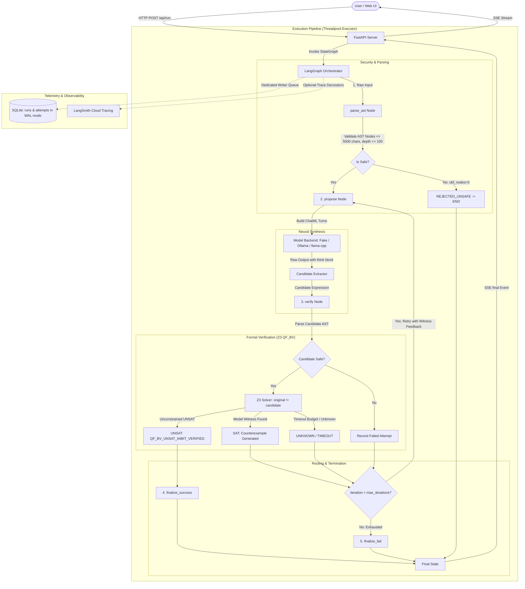

# PALIMPSEST (Codename VEX-MORPH) — Architecture Specification

## 1. Executive Summary & Core Philosophy

**PALIMPSEST** is a local, neurosymbolic de-obfuscation engine for 64-bit Mixed Boolean-Arithmetic (MBA) expressions.

In binary protection, code obfuscators rewrite simple instructions (such as `x + y`) into large, cryptic identities interlaced with opaque predicates (such as `(x ^ y) + 2 * (x & y) + ((x | y) - (x & y)) * 0`). Traditional decompilers rely on rigid pattern-matching heuristics that fail when faced with novel rewrite rules. Solvers alone cannot discover clean, minimal representations because the search space of algebraic expressions is infinite.

PALIMPSEST unites the complementary strengths of Machine Learning and Formal Methods via **Counterexample-Guided Inductive Synthesis (CEGIS)**:
> **"The AI proposes, the math proves."**
> Search is hard, checking is easy.

- **The Neural Proposer**: A fine-tuned, 4-bit quantized SLM (Small Language Model, Qwen2.5-Coder-3B-Instruct) proposes compact candidate expressions.
- **The Symbolic Judge**: Microsoft Z3 (an SMT solver operating over 64-bit BitVec logic, QF_BV) checks candidate equivalence against the original expression. If unequal, Z3 synthesizes a concrete counterexample witness (e.g. `x=1, y=1; expected=2, actual=0`), which is fed back into the model to refine its hypothesis.
- **The Orchestrator**: LangGraph manages the iterative loop, routing proposals through formal verification until an exact mathematical proof is reached or iteration limits are exhausted.

### Honest Claims & Guardrails
- **Zero Unverified Answers Accepted**: PALIMPSEST will **never** present an unverified hypothesis as proven. A candidate is accepted if and only if Z3 emits `UNSAT` on the equivalence miter condition `original != candidate`.
- **Honest Failure**: If the model fails within the retry limit or Z3 times out, the result is visibly flagged as `NOT VERIFIED (FAILED)`.
- **Scope Limit**: PALIMPSEST targets 64-bit MBA expressions. Full binary de-compilation, control-flow flattening, and multi-statement interprocedural analysis are out of scope for v1.

---

## 2. System Architecture



---

## 3. LangGraph State Machine Specification

### 3.1 State Schema (`PalimpsestState`)

```python
from typing import TypedDict, List, Optional, Dict, Any, Callable

class AttemptRecord(TypedDict):
    iteration: int
    candidate: str
    raw_output: str
    think: Optional[str]
    status: str            # "QF_BV_UNSAT_64BIT_VERIFIED" | "SAT" | "UNKNOWN" | "INVALID"
    latency_ms: float
    witness: Optional[Dict[str, int]]
    expected: Optional[int]
    actual: Optional[int]
    diff_bits: Optional[str]  # 64-char binary string of (expected ^ actual)

class PalimpsestState(TypedDict):
    obfuscated_expr: str
    obf_nodes: int
    iteration: int
    max_iterations: int
    current_candidate: Optional[str]
    current_raw_output: Optional[str]
    current_think: Optional[str]
    verification_result: Optional[Dict[str, Any]]
    history: List[AttemptRecord]
    final_status: Optional[str]   # "VERIFIED_EQUIVALENT" | "FAILED" | "REJECTED_UNSAFE"
    final_expr: Optional[str]
    final_nodes: Optional[int]
    compression_pct: Optional[float]
    error_message: Optional[str]
    temperature: float            # Adjusted upwards if model repeats candidates
    feedback_message: Optional[str]
    cancel_callback: Optional[Callable[[], bool]]
```

### 3.2 Graph Nodes

1. **`parse_ast`**:
   - Validates input length ($\le 5000$ characters).
   - Parses AST with Python `ast.parse(expr, mode='eval')`.
   - Enforces the strict Node allowlist, recursion depth threshold ($\le 100$), and rejects negative constant shift amounts.
   - Calculates semantic `obf_nodes` count strictly over `BinOp`, `UnaryOp`, `Name`, and `Constant`.
   - For unparseable or rejected input, `obf_nodes` is explicitly set to `0`.
   - Initializes `iteration = 0`, `history = []`, `temperature = 0.2`.
   - If invalid, sets `final_status = REJECTED_UNSAFE` and routes directly to `END`.

2. **`propose`**:
   - Checks `cancel_callback` at node entry; aborts immediately if client disconnected.
   - Assembles messages matching the training format:
     - Turn 1: `user` $\rightarrow$ `"De-obfuscate this 64-bit MBA expression:\n{expression}"`
     - CEGIS Turns: Formatted previous attempt + Z3 failure witness turn.
   - Dispatches to configured backend with timeout `MODEL_TIMEOUT_SECONDS`.
   - Extracts candidate string from output (lines following `</think>`).
   - Increments `iteration += 1`.
   - If candidate was already proposed in history, raises `temperature += TEMP_RETRY_INCREMENT`.

3. **`verify`**:
   - Checks `cancel_callback` at node entry.
   - Evaluates candidate string against security gate.
   - If candidate is syntactically invalid or unsafe, registers an `INVALID` attempt.
   - Instantiates a fresh, isolated `z3.Context()` and executes the Z3 64-bit BitVec miter check.
   - Computes `diff_bits` when `status == "SAT"`.
   - Appends `AttemptRecord` to `history`.

4. **`finalize_success`**:
   - Sets `final_status = "VERIFIED_EQUIVALENT"`.
   - Counts `final_nodes` and computes `compression_pct = round((1 - final_nodes / obf_nodes) * 100, 2)`.

5. **`finalize_fail`**:
   - Sets `final_status = "FAILED"`.

### 3.3 Routing & Client-Side Graph Synchronization
- Routing logic:
  - If `status == "QF_BV_UNSAT_64BIT_VERIFIED"` $\rightarrow$ `finalize_success`
  - Else if `iteration >= max_iterations` $\rightarrow$ `finalize_fail`
  - Else $\rightarrow$ `propose` (CEGIS loop)
- **Client-Side Router Node**:
  The server emits events for the five functional nodes: `parse_ast`, `propose`, `verify`, `finalize_success`, `finalize_fail`. The "Router" node is drawn **client-side** in the React Flow graph: when a `verification` event arrives, the UI lights up the decision diamond; if followed by a `retry` event, the UI animates the return packet edge along the retry path back to `propose`.

---

## 4. Formal Verification: Z3 Bit-Vector (QF_BV) Contract

### 4.1 Verification Contract
```python
def verify_equivalence(
    original_expr: str,
    candidate_expr: str,
    timeout_ms: int = 3000,
    shift_semantics: Optional[str] = None,
) -> Dict[str, Any]:
    """
    Formally verifies equivalence; equivalence proven by Z3 (QF_BV, 64-bit).
    Uses a fresh z3.Context() per call.
    Returns:
        status: "QF_BV_UNSAT_64BIT_VERIFIED" | "SAT" | "UNKNOWN" | "INVALID"
        witness: dict[str, int] (variable assignments disproving equivalence)
        expected: int | None (original expression value at witness, 64-bit unsigned)
        actual: int | None (candidate expression value at witness, 64-bit unsigned)
        diff_bits: str | None (64-character binary string showing bit discrepancies)
        latency_ms: float
        error: str | None
    """
```

### 4.2 Non-SAT Verification Contract & Retry Feedback Text
- When `status != "SAT"`:
  - `witness`: `{}` (empty dictionary)
  - `expected`: `None`
  - `actual`: `None`
  - `diff_bits`: `None`
- Exact Retry Feedback Strings:
  - When status is `INVALID`:
    ```
    Z3_VERIFICATION_FAILED: INVALID
    Error: <error_message>
    ```
  - When status is `UNKNOWN` (timeout):
    ```
    Z3_VERIFICATION_FAILED: UNKNOWN
    Error: Z3 solver timeout or resource limit reached
    ```

### 4.3 Shift Semantics & Isolation
Configured via `SHIFT_SEMANTICS`:
- **`z3` (Default)**: Standard Z3 / SMT-LIB / Python semantics where shift amounts $\ge 64$ evaluate to $0$.
- **`x86_mask`**: Hardware masking where shift counts are masked to 6 bits (`shift & 63`), so `x << 64 == x`.
- **Negative Shifts**: Constant negative shifts (`x << -1`, `x >> -2`) are rejected at the AST safety gate.

### 4.4 Cascading Bounds & Timeout Budget
- Verification checks bounds in ascending order inside `push()` / `pop()`:
  1. `ULT(v, 2)`: Evaluates binary assignments (yields canonical $x=1, y=1$).
  2. `ULT(v, 16)`: Evaluates small integer assignments.
  3. Fallback: Unconstrained 64-bit query.
- **Critical Invariant**: Bounded `UNSAT` **never** yields `STATUS_VERIFIED`. Only the unconstrained query can emit `QF_BV_UNSAT_64BIT_VERIFIED`.
- **Timeout Management**: Total duration across bounded and unconstrained queries is bounded by timeout plus overhead. Bounded queries receive small slices ($\le 15\%$), and the remainder is allocated to the unconstrained solver.

---

## 5. Security & Isolation Architecture

PALIMPSEST processes untrusted expressions from arbitrary users and generated by local LLMs.
Strict constraints are enforced:
1. **Never `eval()` or `exec()`**: All AST processing is done via safe node traversal.
2. **Strict Node Whitelist**:
   - `ast.Expression`
   - `ast.BinOp` with `Add`, `Sub`, `Mult`, `BitAnd`, `BitOr`, `BitXor`, `LShift`, `RShift`
   - `ast.UnaryOp` with `Invert`, `USub`
   - `ast.Name` with `ast.Load`
   - `ast.Constant` strictly restricted to `isinstance(node.value, int) and not isinstance(node.value, bool)`
   - All other AST types (`Call`, `Attribute`, `Import`, `Str`, `List`, `Lambda`, `Subscript`, etc.) trigger immediate rejection.
3. **DoS Prevention**:
   - Input length limit: $\le 5,000$ characters.
   - Max AST recursion depth: $\le 100$ levels.
4. **Host-Header Protection**:
   FastAPI middleware validates `Host` headers, allowing only `localhost`, `127.0.0.1`, and test runners.

---

## 6. Model Backends & Concurrency Architecture

### 6.1 Backend Interface
```python
class BaseLLMBackend(ABC):
    @abstractmethod
    def generate(
        self,
        messages: List[Dict[str, str]],
        temperature: float = 0.2,
        max_tokens: int = 512,
        should_cancel: Optional[Callable[[], bool]] = None,
    ) -> str:
        pass
```
- Real model backends stream tokens and check `should_cancel()` every chunk; fake backend checks `should_cancel()` at invocation.
- `MODEL_TIMEOUT_SECONDS` is read from configuration (default: 10s).

### 6.2 Concurrency Policy: Single-Slot Lock & HTTP 429
- Local CPU inference cannot handle concurrent runs.
- A process-wide `run_lock = threading.Lock()` gates execution.
- The handler attempts `run_lock.acquire(blocking=False)`.
  - If busy: Returns **HTTP 429 Too Many Requests** immediately with `Retry-After: 5` and JSON `{"error": "PALIMPSEST is currently processing another de-obfuscation run. Only 1 local run is supported concurrently."}`.
  - If acquired: Released strictly in the worker's `finally` block AND if the generator is never iterated.
- Server runs with **1 uvicorn worker** (`workers=1`).

---

## 7. API & Streaming Protocol (SSE)

### 7.1 Thread/Queue Bridge Architecture
```
[FastAPI Async Loop]                              [Worker Thread]
   POST /api/run
     │
     ├─► Creates asyncio.Queue()
     ├─► Creates threading.Event() (cancel_event)
     ├─► Spawns thread via asyncio.to_thread() ──► Runs LangGraph:
     │                                               Checks cancel_event at boundaries
  SSE StreamingResponse                              Emits ONLY via:
     │◄─── loop.call_soon_threadsafe(queue.put) ─────┤ loop.call_soon_threadsafe(
     │                                               │    queue.put_nowait, event)
     ├─► Formats SSE chunk to client
     ├─► try/finally:
     │   generator close / disconnect ──────────────► cancel_event.set()
     └─► 15-second heartbeat: yields ': ping\n\n'
```

### 7.2 Exact Event Ordering (Frozen)
The event stream contract freezes the emission order: **payload events are emitted BEFORE `node_finished`**.

1. Normal Success Loop:
   - `run_started`: `{run_id, expression, obf_nodes, max_iterations, backend}`
   - `node_started`: `{"node": "parse_ast"}`
   - `node_finished`: `{"node": "parse_ast"}`
   - *Iteration 1*:
     - `node_started`: `{"node": "propose"}`
     - `proposal`: `{iteration: 1, raw_output, think, candidate}`
     - `node_finished`: `{"node": "propose"}`
     - `node_started`: `{"node": "verify"}`
     - `verification`: `{iteration: 1, candidate, status: "SAT", latency_ms, witness, expected, actual, diff_bits}`
     - `node_finished`: `{"node": "verify"}`
     - `retry`: `{iteration: 1, feedback_message}`
   - *Iteration 2*:
     - `node_started`: `{"node": "propose"}`
     - `proposal`: `{iteration: 2, raw_output, think, candidate}`
     - `node_finished`: `{"node": "propose"}`
     - `node_started`: `{"node": "verify"}`
     - `verification`: `{iteration: 2, candidate, status: "QF_BV_UNSAT_64BIT_VERIFIED", latency_ms, witness: {}, expected: null, actual: null, diff_bits: null}`
     - `node_finished`: `{"node": "verify"}`
   - `node_started`: `{"node": "finalize_success"}`
   - `node_finished`: `{"node": "finalize_success"}`
   - `final`: `{status: "VERIFIED_EQUIVALENT", final_expr, obf_nodes, final_nodes, compression_pct, total_ms, attempts, reason: null}`

2. Failing Loop (Max Iterations Reached):
   - Iterations $1 \dots K$ execute propose and verify.
   - `node_started`: `{"node": "finalize_fail"}`
   - `node_finished`: `{"node": "finalize_fail"}`
   - `final`: `{status: "FAILED", final_expr: null, obf_nodes, final_nodes: null, compression_pct: 0.0, total_ms, attempts, reason: "..."}`

3. Unsafe Input Sequence (`REJECTED_UNSAFE`):
   - `run_started`: `{run_id, expression, obf_nodes: 0, max_iterations, backend}`
   - `node_started`: `{"node": "parse_ast"}`
   - `node_finished`: `{"node": "parse_ast"}`
   - `final`: `{status: "REJECTED_UNSAFE", final_expr: null, obf_nodes: 0, final_nodes: null, compression_pct: 0.0, total_ms, attempts: 0, reason: "<error_message>"}`

4. Stream Termination Invariant:
   - Exactly **ONE** of `final` OR `error` terminates the stream, followed by stream closure. They are mutually exclusive.

### 7.3 String Serialization Contract
- **SSE & REST JSON**: All 64-bit integer values (`expected`, `actual`, and all dictionary values in `witness`) are serialized strictly as **strings** (e.g. `"expected": "2"`, `"actual": "0"`, `"witness": {"x": "1", "y": "1"}`) to eliminate JavaScript IEEE 754 precision truncation on values $> 2^{53}-1$.
- **Prompt Builder**: Preserves raw Python integer types (`{'x': 1, 'y': 1}`, `Expected: 2, Actual: 0`) character-for-character matching the teammate's training data.

---

## 8. Telemetry & Persistence (SQLite WAL Mode)

### 8.1 Schema
- Database path: `palimpsest.sqlite` (gitignored).
- Connection settings: `PRAGMA journal_mode = WAL;` and `PRAGMA busy_timeout = 5000;` on every connection.
- Tables:
  ```sql
  CREATE TABLE IF NOT EXISTS runs (
      run_id TEXT PRIMARY KEY,
      timestamp TEXT NOT NULL,
      expression TEXT NOT NULL,
      obf_nodes INTEGER NOT NULL,
      final_status TEXT NOT NULL,
      final_expr TEXT,
      compression_pct REAL,
      attempts INTEGER NOT NULL,
      total_ms REAL NOT NULL,
      backend TEXT NOT NULL,
      max_iterations INTEGER NOT NULL
  );

  CREATE TABLE IF NOT EXISTS attempts (
      id INTEGER PRIMARY KEY AUTOINCREMENT,
      run_id TEXT NOT NULL,
      iteration INTEGER NOT NULL,
      candidate TEXT NOT NULL,
      status TEXT NOT NULL,
      latency_ms REAL NOT NULL,
      witness_json TEXT,
      expected TEXT,
      actual TEXT,
      raw_output TEXT,
      FOREIGN KEY (run_id) REFERENCES runs (run_id)
  );

  CREATE INDEX IF NOT EXISTS idx_attempts_run_id ON attempts(run_id);
  ```
- **Dedicated Writer Queue**: Telemetry writes are handled by a dedicated background async queue with error isolation (`try ... except`) so DB errors never interrupt runs.
- **Cancellation**: Disconnected runs are recorded with `final_status = "CANCELLED"`.

---

## 9. Frontend Architecture & Vite Dev Proxy

- Built with React, Vite, TypeScript, Tailwind CSS, Framer Motion, and `@xyflow/react`.
- **Vite Proxy**: `vite.config.ts` proxies `/api` requests to `http://127.0.0.1:8000`.
- **Client Graph**: Visualizes live execution. The Router node is synthesized purely client-side from `verification` and `retry` events.
