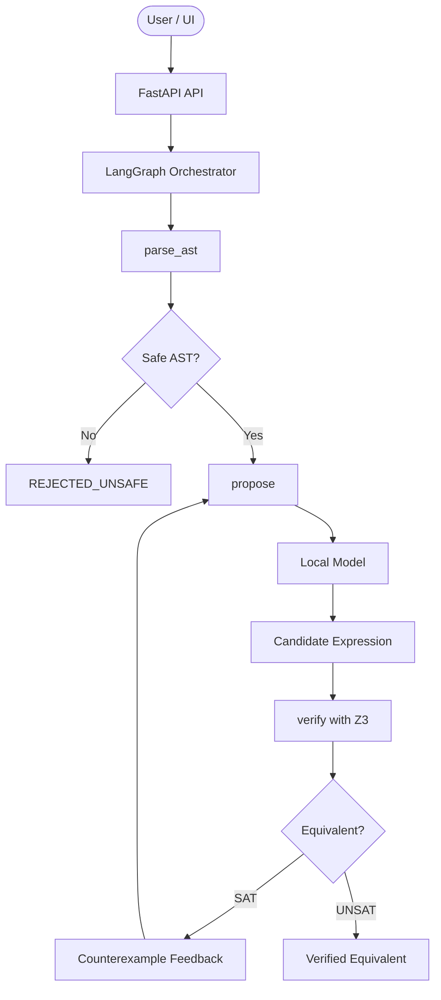

# PALIMPSEST

Proof-first, local de-obfuscation engine for 64-bit mixed boolean-arithmetic (MBA) expressions.

PALIMPSEST combines a local model with formal verification in Z3 to propose, test, and accept only provably equivalent simplifications. It is designed for security-focused reverse-engineering workflows where correctness matters more than a plausible guess.

## Why PALIMPSEST?

Obfuscated arithmetic and bitwise expressions often hide a simple identity inside large algebraic rewrites. Generic decompilers and monolithic LLM-only approaches can produce convincing but incorrect simplifications.

PALIMPSEST enforces a strict proof loop:

1. Parse an expression into a constrained AST.
2. Ask a local model for a candidate rewrite.
3. Verify equivalence with Z3 over 64-bit bit-vectors.
4. If the rewrite is wrong, extract a counterexample and retry.
5. Return only formally verified results.

## Highlights

- Local-only execution with no required cloud dependency
- Z3-based equivalence checking for QF_BV on 64-bit values
- Counterexample-driven repair loop
- Safe AST validation and expression limits
- FastAPI backend with a live React frontend
- SQLite telemetry and run history
- Supports fake, Ollama, and llama.cpp model backends

## System Overview



## Core Workflow

- Parse input and reject unsafe expressions
- Generate a candidate simplification
- Check equivalence with Z3
- Use SAT witness feedback to repair the rewrite
- Accept only proven equivalent expressions

## Repository Structure

```text
palimpsest/
├── ARCHITECTURE.md
├── LICENSE
├── README.md
├── TASKS.md
├── .env.example
├── Modelfile
├── package.json
├── pytest.ini
├── backend/
│   ├── app/
│   ├── requirements.txt
│   └── tests/
├── examples/
│   ├── README.md
│   └── sample_mba_cases.json
├── frontend/
│   ├── package.json
│   └── src/
├── models/
├── scripts/
├── training/
│   ├── ast_slicer.py
│   ├── dataset_generator.py
│   ├── mba_mutator.py
│   └── z3_verifier.py
├── palimpsest.sqlite   # generated locally
└── .gitignore
```

## Tech Stack

- Python: backend orchestration, validation, Z3 integration
- TypeScript / React: frontend UI and telemetry viewing
- Vite: frontend build tooling
- LangGraph: graph-based retry orchestration
- SQLite: local telemetry and history
- Z3: formal equivalence verification

## Quick Start

### Prerequisites

- Python 3.10+
- Node.js 18+
- npm
- Optional: Ollama or a local llama.cpp model

### 1) Clone the repository

```bash
git clone https://github.com/rthivisha/palimpsest.git
cd palimpsest
```

### 2) Set up a Python environment

```bash
python -m venv .venv

# macOS / Linux
source .venv/bin/activate

# Windows PowerShell
# .\.venv\Scripts\Activate.ps1
```

### 3) Install dependencies

```bash
pip install -r backend/requirements.txt
npm install
npm --prefix frontend install
```

### 4) Configure environment variables

```bash
cp .env.example .env
```

The default backend is `fake`, which is useful for local testing and UI demos.

### 5) Run the app

```bash
npm run dev
```

This starts:

- FastAPI backend: http://127.0.0.1:8000
- Vite frontend: http://localhost:5173

Open:

```text
http://localhost:5173
```

## Model Backends

### Fake backend

Used for local development, deterministic demos, and CI flows.

```bash
PALIMPSEST_BACKEND=fake
```

### Ollama backend

```bash
PALIMPSEST_BACKEND=ollama
OLLAMA_BASE_URL=http://127.0.0.1:11434
OLLAMA_MODEL=palimpsest
```

### llama.cpp backend

```bash
PALIMPSEST_BACKEND=llamacpp
LLAMACPP_MODEL_PATH=models/palimpsest-q4_k_m.gguf
LLAMACPP_N_THREADS=4
```

## Example

```bash
python backend/app/cli_demo.py "(x ^ y) + 2 * (x & y)" --backend fake
```

A typical proof flow looks like this:

- Initial candidate: `(x + y) - 1`
- Z3 result: SAT
- Counterexample witness shows the mismatch
- Retry candidate: `x + y`
- Final result: VERIFIED EQUIVALENT

## Key Configuration

The project reads settings from `.env` via `pydantic-settings`.

Common variables:

- `PALIMPSEST_BACKEND`: `fake`, `ollama`, or `llamacpp`
- `OLLAMA_BASE_URL`: Ollama endpoint
- `OLLAMA_MODEL`: model name used for Ollama
- `LLAMACPP_MODEL_PATH`: path to a GGUF model
- `Z3_TIMEOUT_MS`: solver timeout
- `MAX_ITERATIONS`: max repair loops
- `DATABASE_PATH`: local SQLite storage
- `HOST` / `PORT`: API bind settings

## Testing

```bash
pytest -v --durations=10
```

For frontend validation:

```bash
npm run build:frontend
```

## Security and Safety

PALIMPSEST is designed to be local-first and auditable.

Safety controls include:

- AST allowlisting
- strict expression depth and length limits
- no arbitrary code execution
- isolated Z3 verification contexts
- local-only telemetry storage
- proof-first acceptance only

## Documentation

- `ARCHITECTURE.md` — runtime protocol and design notes
- `TASKS.md` — project planning and implementation notes
- `examples/README.md` — benchmark usage and sample cases

## License

This project is licensed under the MIT License. See `LICENSE` for details.

## Repository

https://github.com/rthivisha/palimpsest
