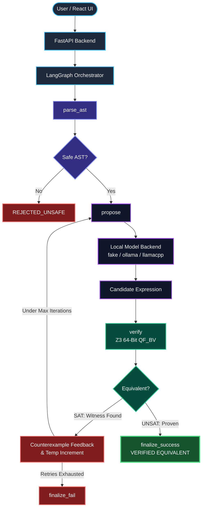
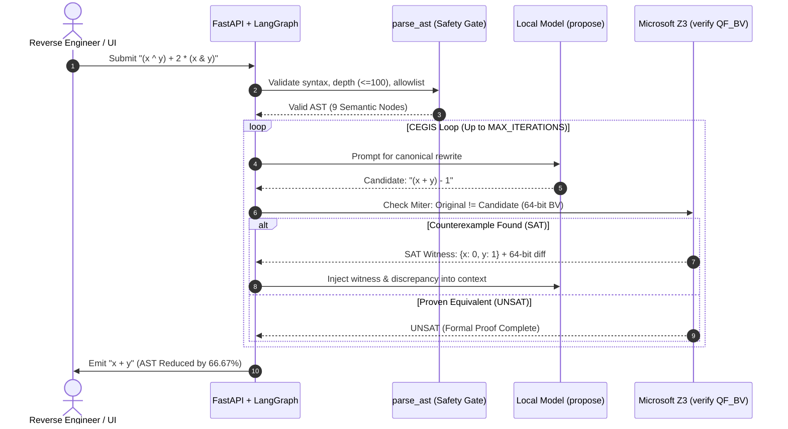

<div align="center">
<pre>
██████╗  █████╗ ██╗     ██╗███╗   ███╗██████╗ ███████╗███████╗███████╗████████╗
██╔══██╗██╔══██╗██║     ██║████╗ ████║██╔══██╗██╔════╝██╔════╝██╔════╝╚══██╔══╝
██████╔╝███████║██║     ██║██╔████╔██║██████╔╝███████╗█████╗  ███████╗   ██║   
██╔═══╝ ██╔══██║██║     ██║██║╚██╔╝ ██║██╔═══╝   ╚════██║██╔══╝  ╚════██║   ██║   
██║     ██║  ██║███████╗██║██║ ╚═╝ ██║██║     ███████║███████╗███████║   ██║   
╚═╝     ╚═╝  ╚═╝╚══════╝╚═╝╚═╝     ╚═╝╚═╝     ╚══════╝╚══════╝╚══════╝   ╚═╝   
</pre>

<p><strong>[ CODENAME: VEX-MORPH // 64-BIT QF_BV ]</strong></p>
<h1>PALIMPSEST</h1>
<h3>A Fully Local, Proof-First, Neurosymbolic 64-Bit Mixed Boolean-Arithmetic (MBA) De-Obfuscation Engine with Formal SMT Equivalence Proofs</h3>
<p>
  <a href="#-why-palimpsest">Why PALIMPSEST</a> •
  <a href="#-architecture-overview">Architecture &amp; CEGIS Loop</a> •
  <a href="#-ollama-cli-proof-example">Live Proof Trace</a> •
  <a href="#-quickstart">Quickstart</a> •
  <a href="#️-environment-variables">Configuration</a> •
  <a href="#-model-integration-guide">Model Backends</a> •
  <a href="#-sample-data-and-test-cases">Benchmarks &amp; Tests</a>
</p>
</div>

---

## ⚡ Overview

PALIMPSEST (VEX-MORPH) is a local, zero-trust neurosymbolic system built to simplify obfuscated 64-bit arithmetic and bitwise expressions by pairing a small local language model with Microsoft Z3 formal verification.

Real-world binary obfuscators routinely conceal simple logic inside bloated algebraic identities that resist manual inspection:

- Mixed Boolean-Arithmetic (MBA) expressions
- Opaque zero terms
- Control-flow flattening patterns
- Algebraic identity rewrites that preserve semantic output while hiding the true underlying expression

> [!IMPORTANT]
> **The Proof-First Mandate:** Instead of trusting a monolithic LLM guess, PALIMPSEST enforces a strict Counterexample-Guided Inductive Synthesis (CEGIS) loop. The local model proposes candidate rewrites, Z3 checks semantic equivalence over 64-bit bit-vectors (QF_BV), and any falsifying SAT counterexample is fed back to repair the candidate until a mathematically proven canonical form is reached.

### The 6-Stage Verification Pipeline

1. **`parse_ast`** — Parse the raw input into a security-guarded, constrained Abstract Syntax Tree (AST).
2. **`propose`** — Generate a simplified candidate expression using a local model (fake, ollama, or llamacpp).
3. **`verify`** — Check formal semantic equivalence in Microsoft Z3 over 64-bit bit-vectors (QF_BV).
4. **Recover SAT Counterexample** — Extract a concrete falsifying bit-vector witness whenever a candidate rewrite is wrong.
5. **Witness-Guided Repair** — Feed the exact counterexample and 64-bit discrepancy back into the model context for iterative retry.
6. **Verified Output Only** — Emit the simplified expression only after Z3 returns UNSAT on the inequivalence miter (VERIFIED EQUIVALENT).

---

## 🎯 Why PALIMPSEST

Obfuscated expressions routinely hide a trivial operation like `x + y` inside a complex algebraic identity such as `(x ^ y) + 2 * (x & y)`. Generic decompilers and standalone LLMs fail in high-assurance reverse engineering because pattern-matching misses novel mutations and raw LLMs hallucinate plausible-looking expressions that break edge cases.

| Capability | Generic Decompilers | Monolithic LLMs | PALIMPSEST (VEX-MORPH) |
|---|---|---|---|
| Handles Novel MBA Mutations | ❌ Rule-bound | ✅ Heuristic | ✅ Neurosymbolic Synthesis |
| Formal 64-Bit Equivalence Proof | ⚠️ Partial | ❌ Hallucinates | ✅ Z3 QF_BV Verified (UNSAT) |
| Counterexample Self-Repair | ❌ None | ❌ Single-shot | ✅ Witness-Guided CEGIS Loop |
| Air-Gapped Local Execution | ✅ Local | ❌ Often Cloud API | ✅ 100% Local (ollama / llamacpp) |
| Execution Safety Gate | ✅ Safe | ⚠️ Unchecked | ✅ Strict AST Allowlist (No `eval()`) |

---

## 🖥️ UI / Product Snapshot

The Vite + React dashboard mirrors the underlying LangGraph state machine and exposes the live formal verification workflow in real time:

- **De-obfuscator Workspace** — Live expression input, AST metrics, and synthesis controls.
- **History & Insights** — SQLite-backed telemetry for past runs and attempt trajectories.
- **Dataset Explorer** — Browse and test curated MBA benchmark identities.
- **Z3 QF_BV Status & Proof Banner** — Displays verified canonical form and exact AST node reduction percentage.
- **LangGraph Execution Graph** — Real-time visual state tracking across parser, model, and solver nodes.
- **Live Counterexample Diagnostics** — Inspect SAT witness assignments and 64-bit bitwise discrepancies across iterations.

### Example Live UI State Transition

```diff
  Original Obfuscated Input : (x ^ y) + 2 * (x & y)
- Candidate (Iteration 1)   : (x + y) - 1
- Z3 Solver Status          : SAT (Counterexample Witness: {'x': 0, 'y': 1})
+ Retry Candidate (Iter 2)  : x + y
+ Final Verification Result : VERIFIED EQUIVALENT (UNSAT on Miter)
```

---

## 🏗️ Architecture Overview

### 1. LangGraph State Machine



### 2. CEGIS Runtime Sequence



### Core System Components

| Node / Module | Responsibility |
|---|---|
| `parse_ast` | Validates the input expression, enforces depth/length bounds, and rejects unsafe syntax. |
| `propose` | Invokes the configured local model backend to synthesize a simplified candidate rewrite. |
| `verify` | Checks 64-bit bitwise and arithmetic equivalence using Microsoft Z3 (QF_BV). |
| `router` | Evaluates solver status and iteration count to route between witness retry and finalization. |
| `finalize_success` | Packages and emits the formally proven canonical form and AST reduction telemetry. |
| `finalize_fail` | Safely terminates execution and emits a failure diagnostic when MAX_ITERATIONS is exhausted. |

---

## 🔬 Ollama CLI Proof Example

Below is an actual execution trace demonstrating how PALIMPSEST catches a near-miss hallucination `((x + y) - 1)`, isolates the 64-bit discrepancy using Z3, and self-repairs to the proven identity `(x + y)`:

```text
> Node Executed: [parse_ast]
> AST Parsed Successfully.
Initial Semantic AST Nodes (BinOp/UnaryOp/Name/Constant): 9

> Node Executed: [propose]
[Iteration 1] Model proposed candidate: '(x + y) - 1'
Reasoning summary: AST Nodes: 13. Initial structural reduction and operator estimation...

> Node Executed: [verify]
Z3 Miter Check Status: SAT (78.89 ms)
Counterexample Witness Discovered (Bounded Bv < 16): {'x': 0, 'y': 1}
Evaluation: Expected 1, Actual 0
Bit Discrepancy (64-bit diff): 0000000000000000000000000000000000000000000000000000000000000001
--> Recycling witness back into model context for retry...

> Node Executed: [propose]
[Iteration 2] Model proposed candidate: 'x + y'
Reasoning summary: Counterexample witness assignment (x=0, y=1) evaluated candidate '(x + y) - 1' to the incorrect value 0. Plugging assignment into candidate isolates the bitwise discrepancy in the evaluated operator. Restoring for algebraic identity yields verified canonical expression x + y...

> Node Executed: [verify]
> Node Executed: [finalize_success]

========================================
[+] RESULT: VERIFIED EQUIVALENT
[+] Proven Canonical Form: x + y
[+] AST Nodes: Final 3 (Reduced by 66.67%)
[+] Equivalence proven by Z3 (QF_BV, 64-bit)
========================================
```

---

## 📂 Repository Layout

```text
palimpsest/
├── .env.example                  # Template environment configuration
├── ARCHITECTURE.md               # Runtime protocol, state machine & verification contract
├── LICENSE                       # MIT License
├── Modelfile                     # Ollama custom model definition
├── README.md                     # Project documentation
├── TASKS.md                      # Engineering roadmap and task breakdown
├── package.json                  # Root workspace orchestration scripts
├── pytest.ini                    # Pytest configuration
├── backend/
│   ├── app/                      # FastAPI application, LangGraph nodes & CLI demo
│   ├── requirements.txt          # Python backend & Z3 dependencies
│   └── tests/                    # API, core logic, and graph routing test suites
├── examples/
│   ├── README.md                 # Benchmark documentation
│   └── sample_mba_cases.json     # Curated 64-bit MBA test cases & near-miss checks
├── frontend/
│   ├── package.json              # Vite + React dependencies
│   └── src/                      # Live proof UI, graph visualizer & telemetry views
├── models/                       # Local GGUF model storage directory
├── scripts/                      # Helper & automation scripts
├── training/
│   ├── ast_slicer.py             # AST decomposition utilities
│   ├── dataset_generator.py      # Synthetic MBA corpus generator
│   ├── mba_mutator.py            # Algebraic identity mutation engine
│   └── z3_verifier.py            # Standalone SMT equivalence verification script
└── palimpsest.sqlite             # Local-only telemetry database (generated at runtime)
```

---

## 🚀 Quickstart

### Prerequisites

- Python 3.10+
- Node.js 18+ & npm
- Optional: Ollama or a local llama.cpp GGUF model

### 1. Clone the Repository

```bash
git clone https://github.com/rthivisha/palimpsest.git
cd palimpsest
```

### 2. Create and Activate a Virtual Environment

```bash
python -m venv .venv

# macOS / Linux
source .venv/bin/activate

# Windows PowerShell
# .\.venv\Scripts\Activate.ps1
```

### 3. Install Backend & Frontend Dependencies

```bash
# Install Python dependencies (FastAPI, LangGraph, Z3, etc.)
pip install -r backend/requirements.txt

# Install root and frontend Node dependencies
npm install
npm --prefix frontend install
```

### 4. Configure Environment Variables

```bash
cp .env.example .env
```

> [!TIP]
> The default backend in `.env.example` is fake, which runs deterministic synthesis out of the box—ideal for instant UI demos, local testing, and CI pipelines without needing a GPU or external weights.

### 5. Launch the Full Stack

```bash
npm run dev
```

This spins up both services concurrently:

- **FastAPI Backend:** http://127.0.0.1:8000
- **Vite + React Frontend:** http://localhost:5173

Open http://localhost:5173 in your browser to start de-obfuscating.

---

## ⚙️ Environment Variables

Configuration is managed via `.env` using pydantic-settings:

### Model & Inference Settings

| Variable | Default | Description |
|---|---|---|
| `PALIMPSEST_BACKEND` | `fake` | Active inference backend: fake, ollama, or llamacpp |
| `OLLAMA_BASE_URL` | `http://localhost:11434` | Local Ollama server endpoint |
| `OLLAMA_MODEL` | `palimpsest` | Target model tag in Ollama |
| `LLAMACPP_MODEL_PATH` | `models/palimpsest-q4_k_m.gguf` | Local path to GGUF model weights |
| `LLAMACPP_N_THREADS` | `CPU count` | CPU thread allocation for llama.cpp |
| `MODEL_TIMEOUT_SECONDS` | `10` | Per-iteration model inference timeout |
| `SYSTEM_PROMPT` | `empty` | Optional custom system prompt override |
| `TOOL_ROLE` | `user` | Message role used for warning/repair feedback |
| `HISTORY_MODE` | `last` | Context history replay mode across iterations |
| `TEMP_RETRY_INCREMENT` | `0.1` | Sampling temperature bump on repeated candidate guesses |

### Z3 Solver, Safety Gate & Server Settings

| Variable | Default | Description |
|---|---|---|
| `Z3_TIMEOUT_MS` | `3000` | Microsoft Z3 solver timeout in milliseconds |
| `MAX_ITERATIONS` | `5` | Maximum CEGIS retry iterations per expression |
| `SHIFT_SEMANTICS` | `z3` | Bitshift verification semantics |
| `MAX_AST_DEPTH` | `100` | Maximum permitted AST depth before rejection |
| `MAX_EXPR_CHARS` | `5000` | Maximum permitted input character length |
| `DATABASE_PATH` | `palimpsest.sqlite` | Local SQLite telemetry database file path |
| `LANGSMITH_TRACING` | `false` | Optional LangSmith trace logging toggle |
| `HOST` | `127.0.0.1` | FastAPI bind host |
| `PORT` | `8000` | FastAPI bind port |

---

## 🧠 Model Integration Guide

### Supported Backend Modes

| Mode | `.env` Configuration | Best For |
|---|---|---|
| Fake | `PALIMPSEST_BACKEND=fake` | Development, CI pipelines, and deterministic UI demos |
| Ollama | `PALIMPSEST_BACKEND=ollama`<br>`OLLAMA_BASE_URL=http://127.0.0.1:11434`<br>`OLLAMA_MODEL=palimpsest` | Local daemon-managed inference with custom Modelfile |
| llama.cpp | `PALIMPSEST_BACKEND=llamacpp`<br>`LLAMACPP_MODEL_PATH=models/palimpsest-q4_k_m.gguf`<br>`LLAMACPP_N_THREADS=4` | Direct in-process GGUF execution without external daemons |

### Option A: Ollama Daemon Setup

Place your model weights in `models/`.

Start the Ollama daemon:

```bash
ollama serve
```

Build the custom palimpsest model from the repository Modelfile:

```bash
ollama create palimpsest -f Modelfile
```

Update `.env`:

```dotenv
PALIMPSEST_BACKEND=ollama
OLLAMA_MODEL=palimpsest
OLLAMA_BASE_URL=http://127.0.0.1:11434
```

Run the CLI proof demo:

```bash
python backend/app/cli_demo.py "(x ^ y) + 2 * (x & y)" --backend ollama
```

### Option B: Direct GGUF via llama.cpp

Install the Python bindings:

```bash
pip install llama-cpp-python
```

Update `.env`:

```dotenv
PALIMPSEST_BACKEND=llamacpp
LLAMACPP_MODEL_PATH=models/palimpsest-q4_k_m.gguf
LLAMACPP_N_THREADS=8
```

### Troubleshooting: Model Offline or Synthesis Failure

If the UI reports MODEL OFFLINE: Ollama is not running at http://127.0.0.1:11434 or synthesis fails:

**Verify Ollama is started:**

In a separate terminal, launch the daemon:

```bash
ollama serve
```

**Check the daemon health:**

Confirm the daemon is listening on port 11434:

```bash
curl http://127.0.0.1:11434/api/tags
```

You should receive a JSON response listing installed models.

**Verify the palimpsest model exists:**

If the UI or CLI reports "Model 'palimpsest' not found; run ollama create palimpsest -f Modelfile", build the model package:

```bash
ollama create palimpsest -f Modelfile
```

Then verify it appears in your local catalog:

```bash
ollama list
```

**Confirm PALIMPSEST connectivity:**

Check the PALIMPSEST system health endpoint:

```bash
curl http://127.0.0.1:8000/api/health
```

The response will confirm:

```json
{
  "status": "healthy",
  "backend": "ollama",
  "model_name": "palimpsest",
  "model_reachable": true,
  "model_unreachable_reason": null
}
```

If `model_reachable` is false, review `OLLAMA_BASE_URL` in `.env` (default: http://127.0.0.1:11434).

---

## 🧪 Sample Data and Test Cases

Curated MBA benchmark expressions are included under `examples/sample_mba_cases.json` and documented in `examples/README.md`.

### Running the Verification & Test Suites

```bash
# Run the full backend test suite (API, Core AST/Z3, and LangGraph routing)
pytest -v --durations=10

# Validate the production frontend build
npm run build:frontend
```

- `backend/tests/test_api.py` — FastAPI endpoint and health contract tests.
- `backend/tests/test_core.py` — AST safety gate and Z3 QF_BV verification unit tests.
- `backend/tests/test_graph.py` — LangGraph state transitions and CEGIS retry loop tests.

### Sample Benchmark JSON

```json
{
  "metadata": {
    "project": "PALIMPSEST",
    "codename": "VEX-MORPH",
    "description": "Benchmark sample expressions for MBA simplification and equivalence verification."
  },
  "cases": [
    {
      "id": "mba_add_identity_01",
      "name": "XOR + carry identity",
      "original": "(x ^ y) + 2 * (x & y)",
      "expected": "x + y",
      "category": "linear_mba",
      "notes": "Classic identity for addition via XOR and carry bits."
    },
    {
      "id": "mba_add_identity_02",
      "name": "OR + AND identity",
      "original": "(x | y) + (x & y)",
      "expected": "x + y",
      "category": "linear_mba",
      "notes": "Equivalent to x + y for unsigned 64-bit integers."
    },
    {
      "id": "mba_xor_identity_01",
      "name": "XOR via OR minus AND",
      "original": "(x | y) - (x & y)",
      "expected": "x ^ y",
      "category": "bitwise_mba",
      "notes": "Standard identity used in mixed arithmetic / bitwise simplification."
    },
    {
      "id": "mba_opaque_zero_01",
      "name": "Opaque zero cancellation",
      "original": "((x | y) - (x ^ y)) - (x & y)",
      "expected": "0",
      "category": "opaque_zero",
      "notes": "Algebraically zero for all valid 64-bit inputs."
    },
    {
      "id": "mba_counterexample_01",
      "name": "Near-miss candidate",
      "original": "(x ^ y) + 2 * (x & y)",
      "candidate": "x ^ y",
      "expected_status": "SAT",
      "notes": "Near-miss candidate fails with a witness like x=0, y=1."
    }
  ]
}
```

---

## 🛡️ Security, Safety & Design Docs

> [!WARNING]
> **Zero-Trust Execution Model:** Untrusted expressions from reverse-engineering targets must never be passed to `eval()`. PALIMPSEST parses all inputs into a restricted AST before any model or solver interaction occurs.

- **Strict AST Allowlisting** — Rejects function calls, attribute access, imports, and non-arithmetic/bitwise constructs.
- **Bounded Complexity** — Enforces `MAX_AST_DEPTH=100` and `MAX_EXPR_CHARS=5000` to prevent parser or solver DoS.
- **No `eval()` or Dynamic Execution** — Expressions are translated strictly into isolated Z3 bit-vector ASTs.
- **Single-Run Inference Locking** — Prevents local hardware contention during concurrent requests.
- **Air-Gapped Telemetry** — All run histories stay inside local `palimpsest.sqlite`.

For deep-dive engineering specifications on the runtime protocol, state machine, safety constraints, and verification contract, see:

- `ARCHITECTURE.md`
- `TASKS.md`

---

## 📄 License

This project is licensed under the MIT License — see the LICENSE file for details.

```text
MIT License

Copyright (c) 2025 PALIMPSEST contributors

Permission is hereby granted, free of charge, to any person obtaining a copy
of this software and associated documentation files (the "Software"), to deal
in the Software without restriction, including without limitation the rights
to use, copy, modify, merge, publish, distribute, sublicense, and/or sell
copies of the Software, and to permit persons to whom the Software is
furnished to do so, subject to the following conditions:

The above copyright notice and this permission notice shall be included in all
copies or substantial portions of the Software.

THE SOFTWARE IS PROVIDED "AS IS", WITHOUT WARRANTY OF ANY KIND, EXPRESS OR
IMPLIED, INCLUDING BUT NOT LIMITED TO THE WARRANTIES OF MERCHANTABILITY,
FITNESS FOR A PARTICULAR PURPOSE AND NONINFRINGEMENT. IN NO EVENT SHALL THE
AUTHORS OR COPYRIGHT HOLDERS BE LIABLE FOR ANY CLAIM, DAMAGES OR OTHER
LIABILITY, WHETHER IN AN ACTION OF CONTRACT, TORT OR OTHERWISE, ARISING FROM,
OUT OF OR IN CONNECTION WITH THE SOFTWARE OR THE USE OR OTHER DEALINGS IN THE
SOFTWARE.
```
